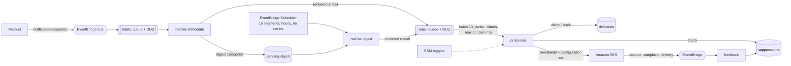
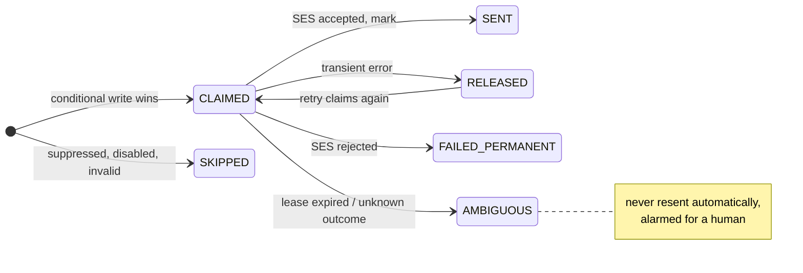
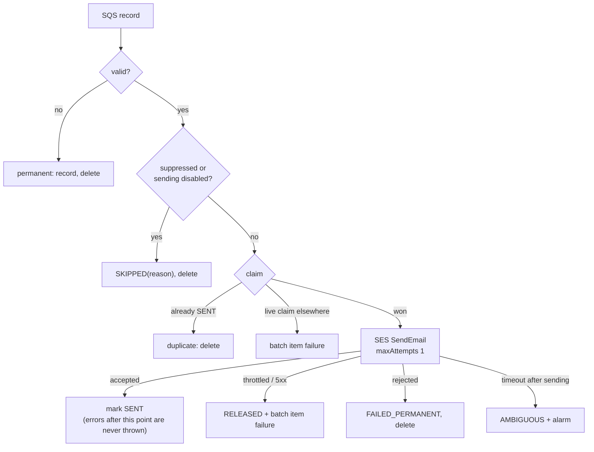

<div align="center">

# Reliable Email Delivery

**Scheduled notification e-mail on AWS that is never sent twice, never lost silently, and never
mailed to an address that bounced.**

EventBridge + SQS + Lambda + DynamoDB + SES, in TypeScript and AWS CDK: claim-before-send
idempotency, classified errors with partial batch responses, a timeout guard, bounce and complaint
suppression, fail-safe kill switches and PII-free logs.

[](https://github.com/the3ma/reliable-email-delivery/actions/workflows/ci.yml)
[](https://github.com/the3ma/reliable-email-delivery/actions/workflows/codeql.yml)


[](LICENSE)

[The problem](#the-problem) ·
[What it does](#what-it-does) ·
[Architecture](#architecture) ·
[Quick start](#quick-start) ·
[How it works](#how-it-works) ·
[Deployment](#deployment) ·
[What is verified](#what-is-verified) ·
[Docs](#documentation)

</div>

---

## The problem

A SaaS product e-mailed its users immediately for some events and as a daily digest for the rest: a
scheduler found who to notify, a queue carried one message per e-mail, a processor sent it through
SES and wrote "sent" to an acknowledgement table that the scheduler checked next time.

It worked - and then, over one week, **87 % of the immediate e-mails were duplicates; one user got the
same notification 118 times**. The "already sent?" check read a record written only _after_ the send,
so overlapping runs and retries all saw "not sent yet". Around it:

- one invalid message was retried until it reached the dead-letter queue;
- one failure re-sent the other nine e-mails of its batch, and a **Lambda timeout re-sent all ten**;
- a failing metrics flush _after_ a successful send marked the e-mail as failed and sent it again;
- large e-mails broke the audit log (DynamoDB's 400 KB limit), and addresses leaked into logs;
- a "suspicious content" regex **silently blocked every daily digest** for days;
- nothing consumed bounces, the DLQ had no alarm, and switching e-mail off needed a deployment.

The full analysis - eleven symptoms, their root causes and ten requirements - is in
[docs/01-the-problem.md](docs/01-the-problem.md).

## What it does

| Capability                     | How                                                                                                                      |
| ------------------------------ | ------------------------------------------------------------------------------------------------------------------------ |
| Never sends twice              | deterministic delivery id + **claim before send** (one conditional write wins); digest id includes the user's local date |
| Never loses silently           | every delivery ends `SENT`, `SKIPPED(reason)`, `FAILED_PERMANENT(reason)` or `AMBIGUOUS` (alarmed, for a human)          |
| Retries only what can succeed  | permanent vs transient vs unknown-outcome errors; `reportBatchItemFailures`; SES client never auto-retries a send        |
| Never times out mid-batch      | remaining-time guard returns unprocessed records 30 s before the deadline                                                |
| Nothing breaks after the send  | every post-send side effect isolated, never re-thrown; guarded metrics flush                                             |
| Honours bounces and complaints | SES configuration set -> EventBridge -> `feedback` -> suppression list checked before every send                         |
| Safe templates                 | escaping-by-default renderer, missing variables are errors; no content blocklists                                        |
| No PII in logs                 | addresses masked or hashed, bodies never logged - asserted by a test that scans every log line                           |
| Fits DynamoDB                  | delivery-log items kept under a 380 KB budget with UTF-8-safe staged shedding                                            |
| Off in seconds, safely         | SSM toggle (cached, stale-on-error, **disabled** when unreadable) + a deploy-time hard switch                            |
| Scales the digest              | 16 hash segments, hourly, each picking users in their local morning; no scheduler retries                                |
| Protects SES reputation        | `maxConcurrency` caps the send rate; bounce/complaint-rate alarms below AWS's review thresholds                          |

## Architecture



| Component      | Path                                       | Stack                                                                                                                                             |
| -------------- | ------------------------------------------ | ------------------------------------------------------------------------------------------------------------------------------------------------- |
| Core           | [`packages/core`](packages/core)           | schemas, delivery ids, claim state machine, error classification, redaction, item budget, toggles, renderer, AWS + SMTP adapters, in-memory fakes |
| Functions      | [`packages/functions`](packages/functions) | `notifier-immediate`, `notifier-digest`, `processor`, `feedback` (Node 22, Powertools, esbuild) + local workers and CLIs                          |
| Templates      | [`templates`](templates)                   | report ready, invoice failed, daily digest - subject, text and HTML                                                                               |
| Infrastructure | [`infra`](infra)                           | AWS CDK v2: EventBridge, SQS + DLQs, DynamoDB, Scheduler, SES configuration set, KMS, SSM, alarms, dashboard; cdk-nag                             |
| Local stack    | [`docker-compose.yml`](docker-compose.yml) | LocalStack (EventBridge, SQS, DynamoDB, SSM), Mailpit for SES                                                                                     |

## Quick start

Requires Docker with Compose v2.

```bash
git clone https://github.com/the3ma/reliable-email-delivery.git
cd reliable-email-delivery
make up      # localstack, mailpit, both workers
make seed    # 40 users across 12 time zones, every 10th address pre-suppressed
make smoke   # publish -> dedup -> suppression -> digest -> kill switch -> bounce feedback
```

Open http://localhost:8025 to see every e-mail. More in [docs/03-running-locally.md](docs/03-running-locally.md).

## How it works

### Claim before send



The delivery id is `sha256(user | category | entity | period)`, so every duplicate request, overlapping
run, redelivery or redrive maps to the same record. Only one worker can win the conditional write; a
loser finds `SENT` and drops its copy, or a live claim and retries later. A worker that dies between
the send and the mark leaves an expired lease - the e-mail may or may not be out, so it becomes
`AMBIGUOUS` instead of being sent again ([ADR 0002](docs/adr/0002-at-most-once-with-ambiguous-alarm.md)).

### One record, three possible errors



Before each record the processor checks the remaining time; 30 seconds before the deadline it hands
the rest back as batch item failures, so a timeout can never redeliver e-mails that already went out
([ADR 0003](docs/adr/0003-classify-errors-and-partial-batches.md)).

### Closing the feedback loop

SES publishes bounce, complaint and delivery events for the configuration set to EventBridge. A
permanent bounce or a complaint puts the SHA-256 of the address on the suppression list, which the
processor checks before claiming. Alarms on the bounce and complaint rates fire at the levels where
SES starts a review, not where it pauses sending
([ADR 0004](docs/adr/0004-suppression-from-ses-feedback.md)).

All six decisions, with the rejected options, are in the [ADRs](docs/adr).

## Deployment

```bash
npm ci && cd infra && npm ci
npx cdk deploy EmailDelivery-dev -c stage=dev -c sendingDomain=example.test
npx cdk deploy EmailDelivery-prod -c stage=prod -c sendingDomain=example.test -c alarmEmail=ops@example.test
```

Production starts with `send-emails = disabled`: verify the domain (the DKIM and MAIL FROM records are
stack outputs), leave the SES sandbox, then enable sending. The
[deploy workflow](.github/workflows/deploy.yml) runs the same, manually, for the repository owner,
through GitHub OIDC. Context flags, alarms and IAM details are in [infra/README.md](infra/README.md);
day-two operations - stopping all mail, DLQ redrive, ambiguous deliveries, bounce spikes - are in the
[operations runbook](docs/04-operations-runbook.md).

Cost is almost entirely per use: about $6 a month fixed (KMS key, alarms, dashboard); 100k e-mails a
month comes to roughly $15-25 at us-east-1 list prices.

## What is verified

|                                                                                                                                                                                | How                                                                                                                                                                                                                   |
| ------------------------------------------------------------------------------------------------------------------------------------------------------------------------------ | --------------------------------------------------------------------------------------------------------------------------------------------------------------------------------------------------------------------- |
| Claim state machine, error classes, timeout guard, never-throw-after-send, kill switches, toggle cache, item budget, redaction, renderer, local-time digest windows across DST | unit tests against in-memory fakes of every port                                                                                                                                                                      |
| Conditional writes and the 380 KB budget against a real DynamoDB API                                                                                                           | integration tests on LocalStack in CI                                                                                                                                                                                 |
| End to end: duplicates, re-publish, digest twice, suppression, kill switch, bounce feedback                                                                                    | the compose smoke test in CI                                                                                                                                                                                          |
| Infrastructure                                                                                                                                                                 | CDK assertions (encryption, DLQs, visibility timeouts, IAM scope, schedules, SES destinations, outputs), a dependency-cycle detector, cdk-nag with zero unsuppressed findings, real esbuild synth                     |
| **Not verified**                                                                                                                                                               | a live AWS deployment: SES sending and its EventBridge events, KMS key policies at run time, Scheduler delivering to the encrypted DLQ. The stack synthesizes and is tested, but has not been deployed by the author. |

## Documentation

| Document                                                 |                                                                           |
| -------------------------------------------------------- | ------------------------------------------------------------------------- |
| [01 - The problem](docs/01-the-problem.md)               | the first design, eleven symptoms, root causes, requirements              |
| [02 - The solution](docs/02-the-solution.md)             | mechanism by problem, runtime view, local vs AWS                          |
| [03 - Running locally](docs/03-running-locally.md)       | stack, smoke test, troubleshooting                                        |
| [04 - Operations runbook](docs/04-operations-runbook.md) | kill switch, DLQ redrive, ambiguous deliveries, bounce spikes, going live |
| [Contract](docs/CONTRACT.md)                             | messages, tables, states, toggles, env vars, metrics                      |
| [ADRs](docs/adr)                                         | the six design decisions                                                  |
| [infra/README.md](infra/README.md)                       | stack, context flags, alarms, costs, cdk-nag suppressions                 |

## License

[MIT](LICENSE)
