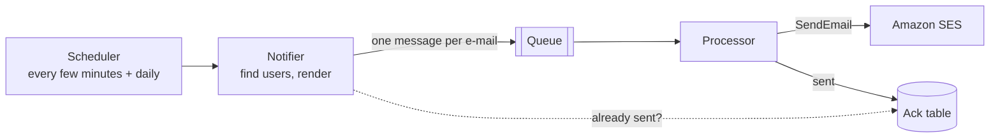

# 1. The problem: notification e-mail that went out twice, or not at all

## Where we started

A SaaS product e-mails its users when something happens - a report is ready, an invoice failed, a
document was shared - either immediately or once a day as a digest. The first version was the
obvious one:

The notifier checked an acknowledgement table to avoid sending the same notification twice; the
processor wrote that acknowledgement after SES accepted the e-mail.

## What went wrong

| #   | Symptom                                                                                                          | Root cause                                                                                                                                                                                                                  |
| --- | ---------------------------------------------------------------------------------------------------------------- | --------------------------------------------------------------------------------------------------------------------------------------------------------------------------------------------------------------------------- |
| 1   | **87 % of "immediate" e-mails over one week were duplicates; one user received the same notification 118 times** | Scheduled runs overlapped, a scheduler retry re-ran a run that was still sending, and the "already sent?" check read an acknowledgement that is only written _after_ the send - every run in that window saw "not sent yet" |
| 2   | One bad message was retried until it reached the dead-letter queue, then the next one                            | Invalid input (unparseable JSON, a malformed address) was thrown like a transient error, so the queue retried it                                                                                                            |
| 3   | One failure re-sent the other nine e-mails of its batch                                                          | Without partial batch responses, any error fails the whole batch; SQS redelivers all ten, including the ones SES had already accepted                                                                                       |
| 4   | A slow database call re-sent a whole batch                                                                       | A Lambda **timeout** bypasses partial batch responses entirely - every record of the batch comes back, sent or not                                                                                                          |
| 5   | Errors _after_ a successful send caused duplicates                                                               | A failed metrics flush or log write after `SendEmail` threw, which marked an already-sent record as failed                                                                                                                  |
| 6   | Large e-mails broke the audit log                                                                                | The log item contained the body; DynamoDB rejects items over 400 KB                                                                                                                                                         |
| 7   | Recipient addresses and bodies appeared in logs                                                                  | The raw event was logged on error                                                                                                                                                                                           |
| 8   | **Every daily digest was silently blocked for days**                                                             | A "suspicious content" regex meant to catch `onclick=` also matched `content=` in the `<meta>` tags of a Word-generated template                                                                                            |
| 9   | Hard bounces kept being mailed                                                                                   | Nothing consumed SES bounce and complaint events; the account's reputation, and with it the right to send, was at risk                                                                                                      |
| 10  | A poison message waited in the dead-letter queue unnoticed                                                       | No alarm on the DLQ, no documented redrive                                                                                                                                                                                  |
| 11  | Turning e-mail off needed a deployment                                                                           | The switch was an environment variable                                                                                                                                                                                      |

## What the replacement had to do

1. **Never send the same notification twice** - not across overlapping runs, retries, redeliveries,
   timeouts or crashes.
2. **Never lose one silently** - every notification ends as sent, skipped (with a reason), failed
   (with a reason) or flagged for a human.
3. Classify errors: permanent errors are recorded once and never retried; transient ones are retried
   per message, never per batch.
4. Never let a Lambda timeout redeliver work that is already done.
5. Never mail an address that bounced permanently or complained.
6. Keep recipient data out of logs and metrics.
7. Templates must be safe by construction (escaping), not by blocklists.
8. Turn sending off in seconds, without a deployment, and fail **safe** when the switch cannot be read.
9. Cap the send rate to protect SES quotas and reputation.
10. Make every failure visible: dead-letter queues, ambiguous deliveries, bounce and complaint rates.

[2 - The solution](02-the-solution.md) shows how each of these is met.
