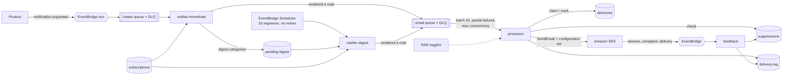

# 2. The solution: claim before send, classify every failure, close the feedback loop

## Mechanism by problem

| Problem (from [1](01-the-problem.md))    | Mechanism                                                                                                                                                                                                                                                                                           |
| ---------------------------------------- | --------------------------------------------------------------------------------------------------------------------------------------------------------------------------------------------------------------------------------------------------------------------------------------------------- |
| 1 Duplicates across runs and retries     | A deterministic **delivery id** (`sha256(user, category, entity, period)`) and a **claim-before-send** record: a conditional write that only one worker can win. The digest period is the user's local date - one digest per user per day, however often a segment runs. Scheduler retries are off. |
| 1 Crash between send and acknowledgement | The claim has a lease. A claim found with an expired lease means "the worker died - sent or not, nobody knows": it becomes `AMBIGUOUS`, is **not** resent, and alarms ([ADR 0002](adr/0002-at-most-once-with-ambiguous-alarm.md)).                                                                  |
| 2 Poison messages                        | Errors are classified: schema/validation/suppressed/disabled/rejected-by-SES are **permanent** (recorded, never retried); throttling, 5xx and network are **transient**                                                                                                                             |
| 3 Whole-batch retries                    | `reportBatchItemFailures`: only the transient records go back to the queue                                                                                                                                                                                                                          |
| 4 Timeouts                               | A remaining-time guard stops taking records 30 s before the deadline and returns the rest as batch item failures - the function never times out mid-batch                                                                                                                                           |
| 5 Errors after the send                  | Every side effect after SES accepted the e-mail runs in its own try/catch and is never re-thrown; the metrics flush is guarded                                                                                                                                                                      |
| 6 400 KB items                           | The delivery log has a 380 KB budget with a staged shedding order (body, provider response, raw request, details), UTF-8-safe truncation and re-measurement after serialisation                                                                                                                     |
| 7 PII in logs                            | Addresses are masked (`a***@example.test`) or hashed; bodies are never logged (`[omitted: N chars]`); a test scans every log line of the handler tests for addresses and body text                                                                                                                  |
| 8 Template blocklist                     | A small Mustache-style renderer that **escapes by default** and fails on missing variables; no content regexes                                                                                                                                                                                      |
| 9 Bounces and complaints                 | An SES **configuration set** publishes events to EventBridge; the `feedback` function writes permanent bounces and complaints to a **suppression list** that the processor checks before every send (plus the configuration set's own suppression)                                                  |
| 10 Silent DLQs                           | Alarms on every DLQ, on queue age, on ambiguous deliveries, on bounce and complaint rates; a documented redrive with `StartMessageMoveTask`                                                                                                                                                         |
| 11 Switch needs a deploy                 | SSM toggle `send-emails`, cached 5 minutes, stale value on refresh errors, **disabled** when nothing can be read; plus a deploy-time hard switch where anything but the literal `false` disables sending                                                                                            |
| Send rate                                | The processor's SQS event source `maxConcurrency` caps parallel senders, so the queue absorbs bursts instead of SES throttling them                                                                                                                                                                 |

## Decisions

| ADR                                                     | Decision                                                                          |
| ------------------------------------------------------- | --------------------------------------------------------------------------------- |
| [0001](adr/0001-split-notifier-and-processor.md)        | Split rendering (notifier) from delivery (processor) with a queue between them    |
| [0002](adr/0002-at-most-once-with-ambiguous-alarm.md)   | Claim before send; at-most-once with an alarmed `AMBIGUOUS` state                 |
| [0003](adr/0003-classify-errors-and-partial-batches.md) | Permanent vs transient errors, partial batch responses, the remaining-time guard  |
| [0004](adr/0004-suppression-from-ses-feedback.md)       | Bounce/complaint feedback through a configuration set into a suppression list     |
| [0005](adr/0005-fail-safe-kill-switches.md)             | Two kill switches that fail safe                                                  |
| [0006](adr/0006-segmented-digest-in-local-time.md)      | The daily digest as 16 independent, idempotent segments in each user's local time |

## Runtime view

## What runs where

|                                    | Local (docker compose)                                             | AWS (CDK)                                         |
| ---------------------------------- | ------------------------------------------------------------------ | ------------------------------------------------- |
| Event bus, queues, tables, toggles | LocalStack                                                         | EventBridge, SQS (KMS), DynamoDB (KMS, PITR), SSM |
| Notifier, processor                | long-polling worker containers running the same handlers           | Lambda with SQS event sources                     |
| Digest schedule                    | `jobs digest -- --segment N`                                       | EventBridge Scheduler, 16 schedules               |
| Mail                               | Mailpit over SMTP                                                  | SES v2 with a configuration set                   |
| Bounces / complaints               | `jobs feedback -- --type bounce --email ...` builds the same event | SES -> EventBridge -> feedback                    |
